# CloudPanel (Rust Edition)

A lightweight, self-contained server control panel written in Rust. One static binary serves the web UI and API and manages everything a VPS needs: sites with their own Linux users, supervised Node.js/Python apps, nginx, Let's Encrypt, databases, files, backups, services, updates, Docker, the firewall, fail2ban, cron and alerts.

- **Single binary**: the UI is embedded with `rust-embed`, and there are no PHP, Node or Python runtimes to maintain.
- **Small footprint**: Tokio + Axum + embedded SQLite.
- **Secure defaults**: HTTPS out of the box, Argon2id passwords, optional TOTP 2FA, role-based access, an audit log, strict input validation and a strict Content-Security-Policy.

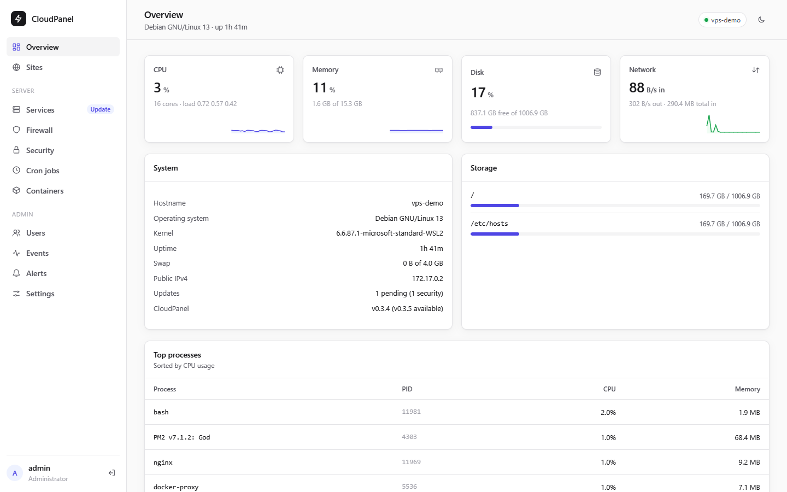

More in [Screenshots](#screenshots).

## Install on a VPS

Supported: **Debian 11 / 12 / 13** and **Ubuntu 22.04 / 24.04** on amd64 or arm64, on a fresh server with root access.

```bash
curl -fsSL https://raw.githubusercontent.com/marwinlewis/cloudpanel-rust/main/install.sh | sudo bash
```

The installer asks which database engines sites may use (MySQL/MariaDB, MongoDB, SQLite). To answer up front, for example with Docker as well:

```bash
curl -fsSL https://raw.githubusercontent.com/marwinlewis/cloudpanel-rust/main/install.sh | sudo bash -s -- --with-docker --databases mariadb,mongodb,sqlite
```

The installer:

1. Installs `nginx`, `certbot` (+ nginx plugin), `ufw`, `fail2ban`, `cron`, `openssl` and `unzip` with apt, plus the database engines you chose (MongoDB from the official repo.mongodb.org repository, with authorization enabled).
2. Downloads the latest release binary for your CPU and verifies its SHA-256 checksum. If no release exists, it builds from source, adding a temporary swap file on small servers.
3. Creates `/etc/cloudpanel/cloudpanel.env` (mode 600) and a self-signed TLS certificate for the panel.
4. Creates the `cloudpanel-users` / `cloudpanel-sftp` groups, a certbot hook that reloads nginx after renewals, and a hardened systemd service.
5. Opens SSH (detected from `sshd -T`), 80, 443 and the panel port in UFW *before* enabling it, so your SSH session stays up.
6. Prints the panel URL and a randomly generated admin password.

Then open `https://<server-ip>:8443`. Your browser will warn about the self-signed certificate until you issue a real one under **Settings → Panel certificate**.

### Options

| Flag | Description |
| :--- | :--- |
| `--version v0.2.0` | Install a specific release |
| `--from-source` | Build from source instead of downloading a binary |
| `--binary PATH` | Install a locally built binary (offline installs, testing) |
| `--branch NAME` | Branch to build with `--from-source` (default `main`) |
| `--with-docker` | Install Docker Engine from the official docker.com repository |
| `--with-mariadb` | Install MariaDB (MySQL-compatible) for site databases |
| `--with-mongodb` | Install MongoDB Community (8.0; 7.0 on Debian 11; amd64 only on Debian) |
| `--with-sqlite` | Enable SQLite site databases |
| `--databases LIST` | Comma-separated `mariadb,mongodb,sqlite` (skips the question) |
| `--with-php` | Enable PHP sites and install PHP-FPM (asked if you're at a terminal; off otherwise) |
| `--no-php` | Don't enable PHP sites, and don't ask |
| `--no-upgrade` | Never upgrade packages that are already installed |
| `--no-fail2ban` | Don't install fail2ban |
| `--port N` | Panel port (default `8443`) |
| `--no-firewall` | Don't touch UFW |
| `--force` | Try anyway on an untested Debian/Ubuntu derivative |
| `--uninstall` | Remove the binary and service (keeps data) |
| `--uninstall --purge` | Also delete `/var/lib/cloudpanel`, `/etc/cloudpanel` and the managed config files |

Pass flags after `bash -s --`, e.g. `... | sudo bash -s -- --port 9443`.

### Update or add a database engine

Run the same install command again. It replaces the binary, restarts the service, and keeps your data, secrets and certificate. Adding `--with-mariadb` / `--with-mongodb` / `--with-sqlite` installs and enables that engine.

### Moving from CloudPanel CE

`migrate-from-ce.sh` moves a server from CloudPanel CE to this panel in place, without restarting what serves its sites, and can go back at any time. See [Migrating from CloudPanel CE](docs/migrating-from-cloudpanel-ce.md).

### Forgot the admin password or lost your 2FA device?

```bash
sudo cloudpanel user-reset-password --username admin
sudo cloudpanel user-disable-2fa --username admin
```

## Features

**Sites**
- Node.js, Python, static sites, generic reverse proxies and Docker proxies, each with its own nginx vhost. PHP sites too, if you enable PHP when installing, each with its own PHP-FPM pool running as the site user.
- Every site gets its own **Linux user** and home (`/home/<user>/htdocs/<domain>`). nginx reads static files through the site group.
- **App process manager**: apps run as the site user with auto-restart, start/stop/restart, live output and a hardened systemd unit (`cloudpanel-app-<domain>`) that brings them back at boot. Node.js sites choose per site between **PM2** (the default for new sites) and plain **systemd**; other app types use systemd.
  - **PM2** adds zero-downtime reload, cluster mode, a memory limit, scheduled restarts, per-process status and log rotation, and uses `ecosystem.config.{js,cjs}` when the working directory has one. Each site user has their own daemon in `~/.pm2`, so `pm2 ls` over SSH shows what the panel shows. A daemon started by hand can be taken over.
  - **Install dependencies**, **Build** and **Deploy** (install, build, restart) are separate jobs. They detect npm, yarn and pnpm from the lockfile. Prebuilt deploys (build output and `node_modules`, but no source or lockfile) are left alone.
- **Environment variables** live in the `.env` file in the app's working directory. The Application tab and the File Manager edit the same file, and apps pick it up when they start. The site's app port always wins over a `PORT` in `.env`.
- **Site settings**: app port, `www.` handling, WebSocket support, upload limit, document root, enable/disable (maintenance page), HTTP basic auth with an IP allow-list, and custom nginx directives (admins only, checked with `nginx -t`).
- **www**: new sites redirect `www.<domain>` to the naked domain. You can serve both instead, or not handle www at all, per site.
- **SSL**: one-click Let's Encrypt or your own certificate, certificate details and expiry, renew now, disable HTTPS. HTTP redirects to HTTPS. Let's Encrypt certificates include www when it resolves; if it can't be validated, the certificate covers the naked domain and the panel tells you.
- **SSH/SFTP users** per site sharing the site's files, SFTP-only accounts (`internal-sftp`), passwords and authorized keys. Keys live in root-owned files, so a site cannot rewrite them.
- **File manager**: browse, edit, upload (up to 1 GB, drag and drop), download, rename/move, delete, chmod, and extract or compress archives. It is confined to the site home and safe against symlink escapes.
- **Databases**: MySQL/MariaDB, MongoDB and SQLite. Create databases and users, reset passwords (shown once, never stored), export/download and import dumps.
- **Backups**: files and database dumps as `tar.gz`, run now or on a daily/weekly schedule with retention, optional copies to S3-compatible storage (AWS, R2, B2, Wasabi, MinIO), download, and one-click restore. The panel can also back up itself.
- **Logs**: nginx access and error logs, app output, and the generated vhost.

**Server**
- **Services**: status and memory of nginx, SSH, cron, fail2ban, Docker, MariaDB/MySQL, MongoDB, UFW and site apps. Start, stop, restart and reload them, and read their journal.
- **Updates**: check for apt updates (security updates are flagged), install them all, and see when a reboot is required. You can reboot from the panel.
- **CloudPanel updates**: the panel looks for a new release daily, and you can check any time under *Services → Updates*. A new version is flagged in the sidebar and sent once to your notification channels, along with the command that installs it.
- **Firewall**: UFW port and port-range rules, optionally limited to a source IP/CIDR, and an IP block list. Rules that would block SSH or the panel for your own address are refused. The most specific rule wins whatever order you add them in: rules naming a source come first, then denies for everyone, then allows for everyone.
- **Panel hostname**: give the panel its own hostname to open it at `https://<hostname>`. You can then close its port in *Settings → Panel certificate*, from a session on that hostname, so that it only listens on loopback. If the hostname can't be served, the port opens again on the next start; otherwise reach it with `ssh -L 8443:127.0.0.1:8443` or reopen it with `cloudpanel panel-access-open`.
- **Security**: fail2ban jails for SSH and the panel login, with ban time, retries, an ignore list, ban/unban and live status.
- **Cron**: create, edit, pause and run jobs now. Every run's exit code and output are recorded, and jobs can be tied to a site and run as its user.
- **Containers**: list, start/stop/restart, logs, stats and removal. Run new containers from a form (ports are bound to 127.0.0.1 by default), manage images (pull/remove/prune), handle Docker Compose stacks, and expose a container on a domain.
- **Overview**: live CPU, memory, disk and network graphs, top processes, public IPs and pending updates.

**Administration**
- **Users**: administrators and site managers. Site managers only see and manage the sites assigned to them.
- **Two-factor authentication** (TOTP) with QR enrollment and single-use recovery codes.
- **Events**: audit log of sign-ins and every change, with filters and CSV export (kept 90 days).
- **Alerts**: email (SMTP), Slack, Discord or JSON webhooks for high disk/CPU/memory, expiring certificates, stopped services or apps, failed backups and security events.
- **Panel certificate**: issue a Let's Encrypt certificate for the panel hostname. It is hot-reloaded and renewed automatically.

## Screenshots

Taken from a real install on a Debian 13 test container, with demo sites and data.

| | |
| :--- | :--- |
| **Sites**<br>[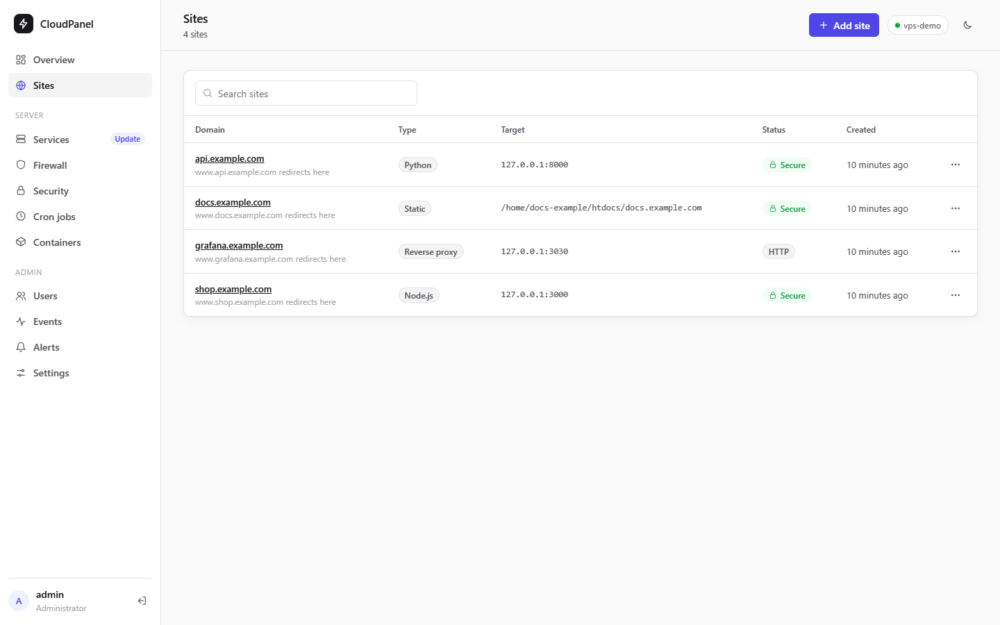](docs/screenshots/sites.png) | **Dark mode**<br>[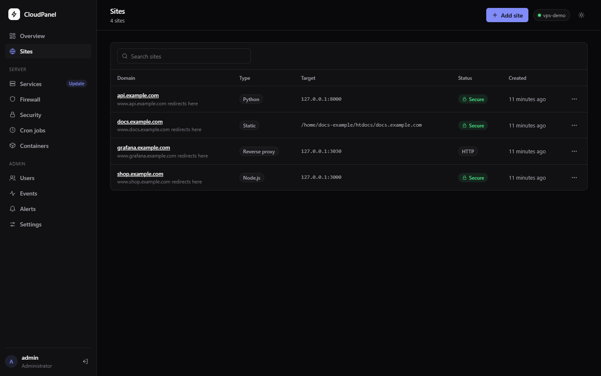](docs/screenshots/sites-dark.png) |
| **Application**<br>[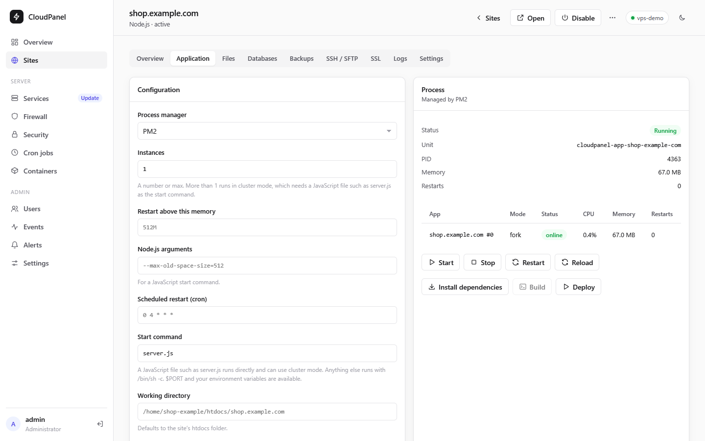](docs/screenshots/site-application.png) | **File manager**<br>[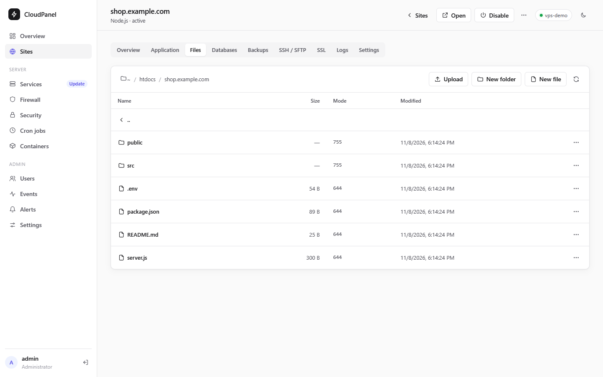](docs/screenshots/site-files.png) |
| **Databases**<br>[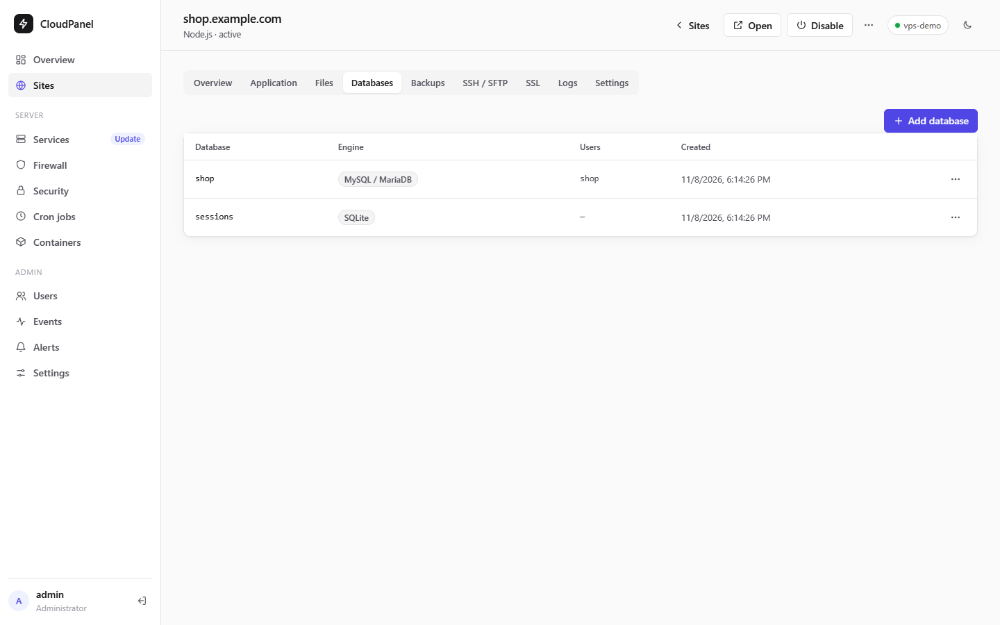](docs/screenshots/site-databases.png) | **Backups**<br>[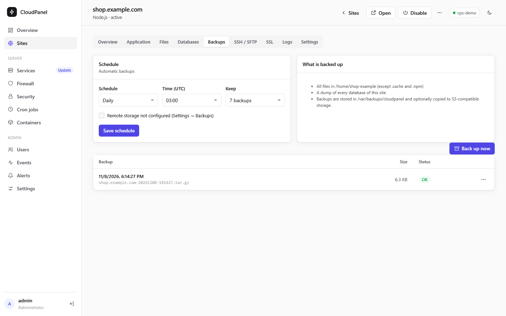](docs/screenshots/site-backups.png) |
| **Services**<br>[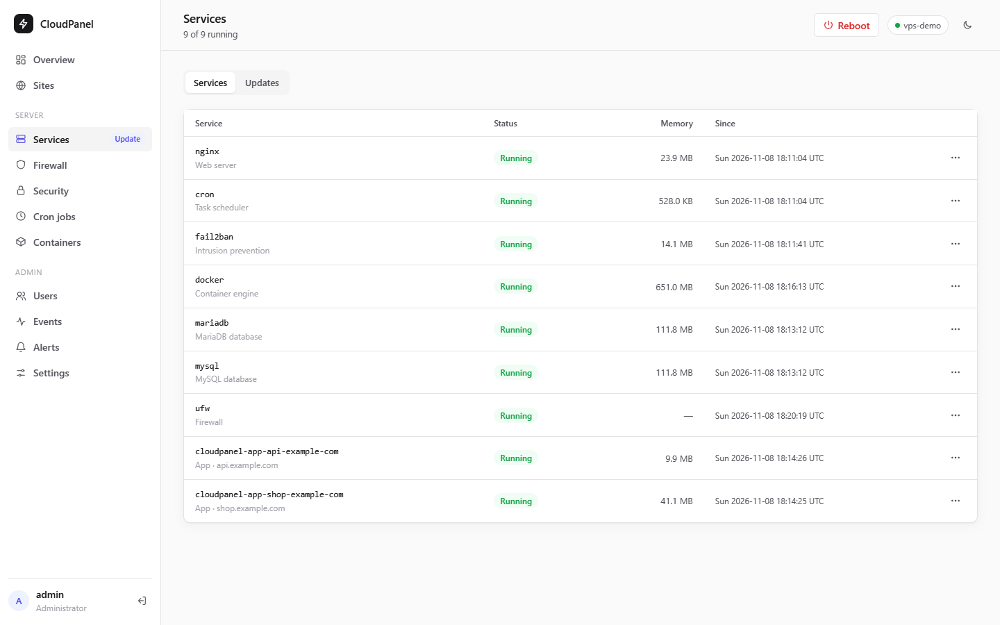](docs/screenshots/services.png) | **Updates**<br>[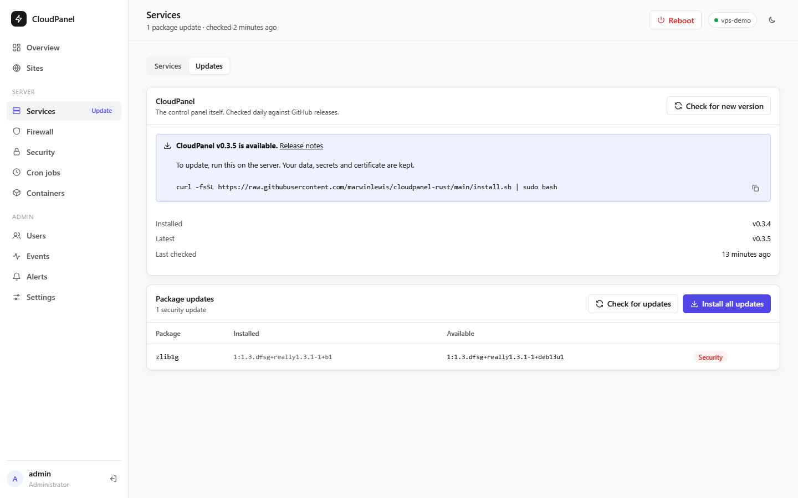](docs/screenshots/updates.png) |
| **Firewall**<br>[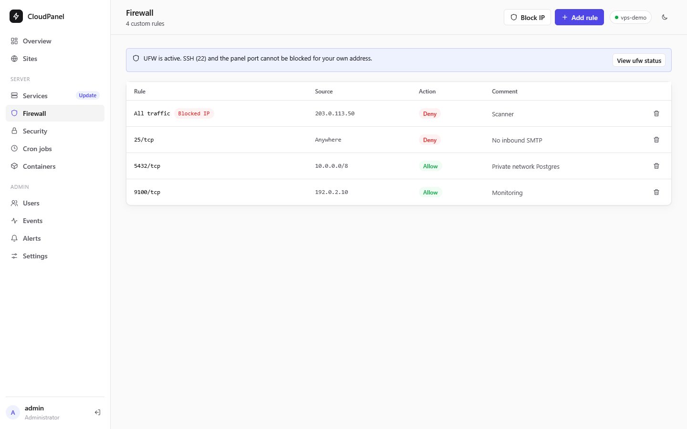](docs/screenshots/firewall.png) | **Security**<br>[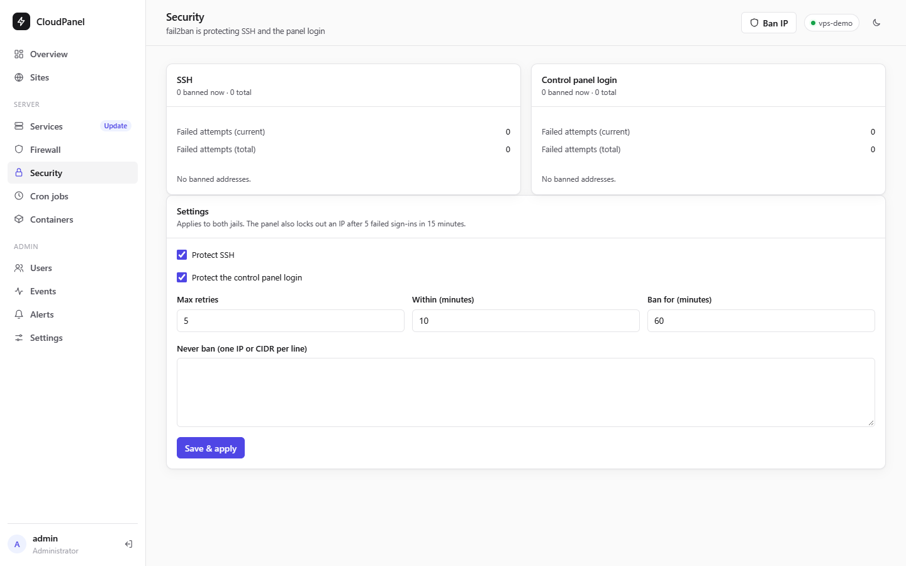](docs/screenshots/security.png) |
| **Cron jobs**<br>[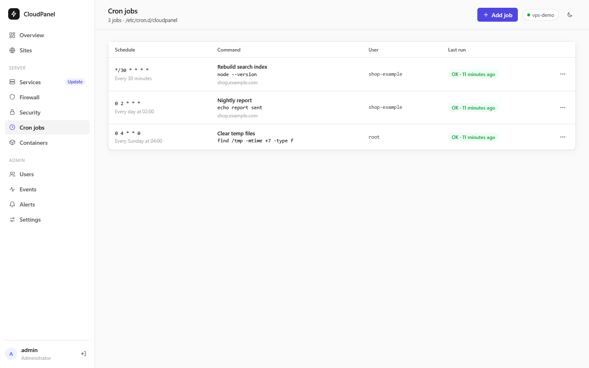](docs/screenshots/cron.png) | **Containers**<br>[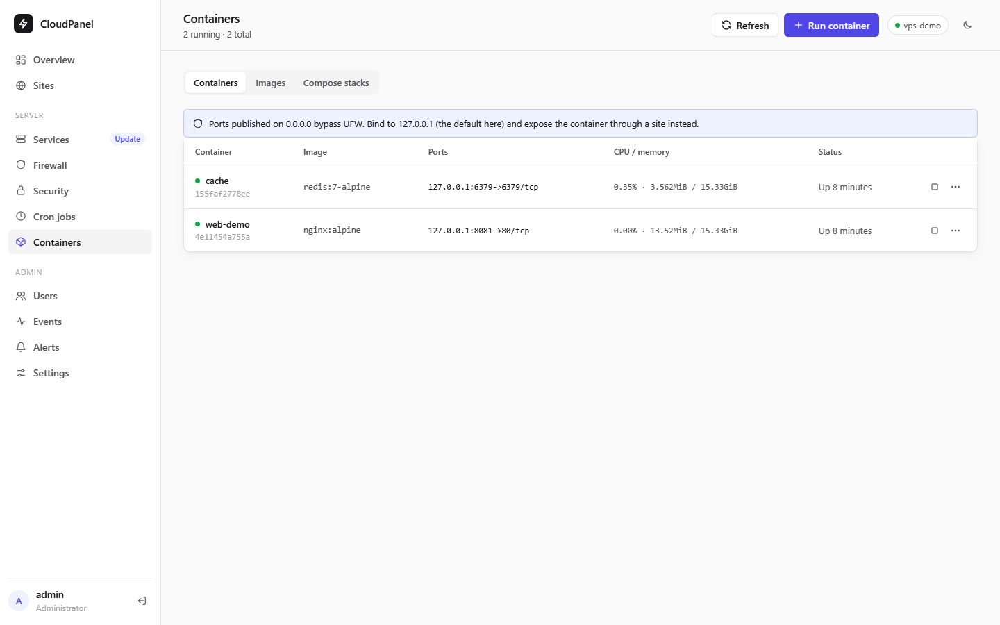](docs/screenshots/containers.png) |
| **Events**<br>[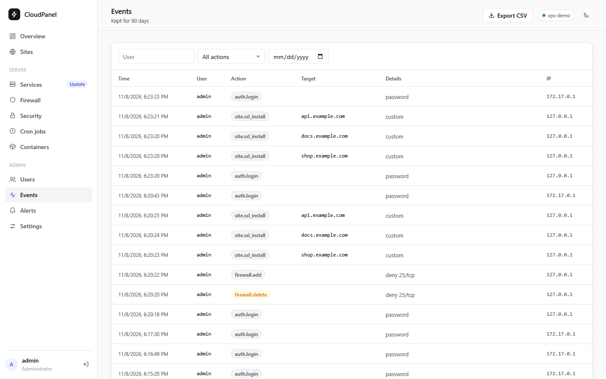](docs/screenshots/events.png) | |

## Security model

| Area | What CloudPanel does |
| :--- | :--- |
| Transport | Serves HTTPS natively (rustls). HSTS when TLS is on. The panel certificate can be swapped for Let's Encrypt without a restart. |
| Authentication | Argon2id password hashes and constant-time handling of unknown users. Optional TOTP 2FA with single-use recovery codes. Per-IP lockout after 5 failed logins in 15 minutes, plus fail2ban on `/var/log/cloudpanel/auth.log`. A ban from the panel's jail is enforced by the panel rather than the firewall, so the client is refused on the hostname and on the panel's own port, directly or through Cloudflare, while hosted sites stay reachable. A Cloudflare address is never banned. |
| Sessions | HS256 JWT in an `HttpOnly; Secure; SameSite=Strict` cookie, 12-hour lifetime. The signing key is random per install. Changing the password or role, or choosing "Sign out everywhere", revokes all tokens. The token between the password and 2FA steps is short-lived and can never be used as a session. |
| Authorization | Admins manage the server. Site managers can only reach assigned sites; other sites answer 404. Custom nginx directives, Docker, services, firewall and users are admin-only. |
| CSRF | State-changing requests need a custom header and a same-origin `Origin`/`Sec-Fetch-Site`. No CORS. |
| Input | Domains, ports, emails, users, keys, CIDRs, database identifiers, image names, paths and cron schedules are validated against strict allow-lists before they reach a config file, the filesystem or a command line. Commands run via `execve`, never through a shell (cron commands and app start commands are deliberately run by `/bin/sh` as the configured user). |
| nginx / sshd / fail2ban | Every change is tested (`nginx -t`, `sshd -t`, `fail2ban-client -t`) and rolled back if rejected. |
| Secrets | Database and SSH passwords are never stored. S3 keys, SMTP passwords and webhook URLs are encrypted with ChaCha20-Poly1305 using a key in `/etc/cloudpanel/secret.key` (mode 600). |
| Browser | Strict CSP (`default-src 'self'`, no inline scripts or styles), `X-Frame-Options: DENY` and `nosniff`. The UI never inserts server data as HTML; the 2FA QR code is drawn from a module matrix. |
| Audit | Sign-ins (including failures) and every change are recorded with user, IP and time. |
| Behind Cloudflare | On the panel's hostname and its own port, `CF-Connecting-IP` names the client only on a connection from Cloudflare's published address ranges. Anyone else's copy of the header is ignored, so servers not using Cloudflare behave the same. The ranges are fetched from Cloudflare's API daily and rejected if implausible. A built-in copy is used until the first fetch succeeds, and **Settings → Panel certificate** shows the list's age. |
| Service | Runs as root, because it manages users, nginx, certbot, ufw, cron and systemd. It runs under systemd hardening (`NoNewPrivileges`, `ProtectSystem=full`) with write access only to the paths it manages. Tools that must rewrite `/etc/passwd` or `/usr` (`useradd`, `apt-get`) run in transient units via `systemd-run`. Site apps run as their site user with `ProtectSystem=strict`. |

> **The panel is root-equivalent.** Any administrator can run commands as any user through cron jobs, containers and custom nginx directives. Use strong passwords, enable 2FA, and consider limiting the panel port to your IP: `ufw delete allow 8443/tcp && ufw allow from <your-ip> to any port 8443 proto tcp`.

> **Docker and UFW:** ports published by Docker on 0.0.0.0 bypass UFW. The panel binds published ports to `127.0.0.1` by default. Expose containers through a site instead.

## Configuration

Settings are read from the environment. The installer writes them to `/etc/cloudpanel/cloudpanel.env`.

| Variable | Default (Linux) | Description |
| :--- | :--- | :--- |
| `CLOUDPANEL_BIND` | `0.0.0.0:8443` | Listen address |
| `CLOUDPANEL_DATA_DIR` | `/var/lib/cloudpanel` | Database, JWT key, uploaded certificates, compose stacks |
| `CLOUDPANEL_DB_PATH` | `$DATA_DIR/cloudpanel.db` | SQLite database file |
| `CLOUDPANEL_TLS_CERT` / `CLOUDPANEL_TLS_KEY` | unset (plain HTTP) | PEM certificate and key for the panel (a Let's Encrypt panel certificate overrides these) |
| `CLOUDPANEL_JWT_SECRET` | generated | Override the signing key (32+ characters) |
| `CLOUDPANEL_DB_ENGINES` | set by the installer | Enabled site database engines: `mariadb,mongodb,sqlite` |
| `CLOUDPANEL_PHP` | set by the installer | `1` enables PHP sites |
| `CLOUDPANEL_HOME_DIR` | `/home` | Parent of site users' homes |
| `CLOUDPANEL_SITES_DIR` | `/var/www` | Document roots of sites created before v0.3 |
| `CLOUDPANEL_BACKUP_DIR` | `/var/backups/cloudpanel` | Backups and database exports |
| `CLOUDPANEL_ETC_DIR` | `/etc/cloudpanel` | App env files, htpasswd files, encryption key, MongoDB credentials |
| `CLOUDPANEL_LOG_DIR` | `/var/log/cloudpanel` | Panel auth log (read by fail2ban) |
| `CLOUDPANEL_SYSTEMD_DIR` | `/etc/systemd/system` | Where app units are written |
| `CLOUDPANEL_STACKS_DIR` | `$DATA_DIR/stacks` | Docker Compose stacks |
| `CLOUDPANEL_NGINX_AVAILABLE` / `_ENABLED` | `/etc/nginx/sites-{available,enabled}` | nginx vhost directories |
| `CLOUDPANEL_NGINX_LOG_DIR` | `/var/log/nginx` | Per-site access and error logs |
| `CLOUDPANEL_FAIL2BAN_DIR` | `/etc/fail2ban` | fail2ban configuration root |
| `CLOUDPANEL_BAN_DIR` | `/run/cloudpanel-bans` | Addresses banned from the panel, kept by fail2ban's action |
| `CLOUDPANEL_SSHD_DIR` | `/etc/ssh/sshd_config.d` | sshd drop-in directory (SFTP-only users) |
| `CLOUDPANEL_CRON_FILE` | `/etc/cron.d/cloudpanel` | Generated crontab |
| `CLOUDPANEL_CLOUDFLARE_IPS_URL` | `https://api.cloudflare.com/client/v4/ips` | Where Cloudflare's address ranges are fetched from |
| `CLOUDPANEL_RELEASE_URL` | `https://api.github.com/repos/marwinlewis/cloudpanel-rust/releases/latest` | Where the latest CloudPanel release is looked up |

Scheduled backups use UTC times. Restoring a **panel** backup is manual: stop the service, extract the archive and put `cloudpanel.db`, `/etc/cloudpanel`, the vhosts and the cron file back in place.

## CLI

```bash
cloudpanel server                                   # start (default)
cloudpanel user-add --username alice --email alice@example.com   # prompts for password
cloudpanel user-reset-password --username admin     # prompts for password, signs out sessions
cloudpanel user-disable-2fa --username admin        # turn off 2FA (lost device)
cloudpanel site-add --domain api.example.com --site-type nodejs --port 3000 [--no-www | --www-alias]
cloudpanel site-list
cloudpanel panel-access-open                        # reopen the panel's port after closing it in Settings
cloudpanel cron-run <id>                            # used by /etc/cron.d/cloudpanel
```

The old `user:add`-style names still work as aliases.

## Development

```bash
cargo run            # http://localhost:8443, data stored in ./data
cargo test
cargo clippy --all-targets -- -D warnings
```

To test a real install, run the installer with a locally built binary on a disposable Debian/Ubuntu machine and then the end-to-end smoke test:

```bash
sudo bash install.sh --binary ./cloudpanel --databases mariadb,mongodb,sqlite
sudo bash scripts/smoke-test.sh
```

Or test on a throwaway Debian 13 container with real systemd, which needs only Docker. It builds the binary, installs it, and checks site apps (PM2 and systemd), `.env` handling and the www redirect through the API, including a reboot:

```bash
scripts/debian-e2e/run.sh
```

On Windows and in local development, system tools (nginx, ufw, certbot, systemctl, useradd, …) are skipped when they aren't installed, and configs are written under `./data`. The UI lives in `ui/` as plain ES modules (`ui/js/core.js` for shared helpers, one module per page under `ui/js/pages/`).

### Releasing

Push a tag such as `v0.3.0`. The release workflow builds static musl binaries for x86_64 and aarch64, publishes them with `.sha256` checksums, and the installer picks them up automatically. The binaries take their version from the tag, so `Cargo.toml` doesn't need bumping for a release to report the right one and for panels to stop offering it once it is installed. Builds from source report the version in `Cargo.toml`.

## License

MIT
